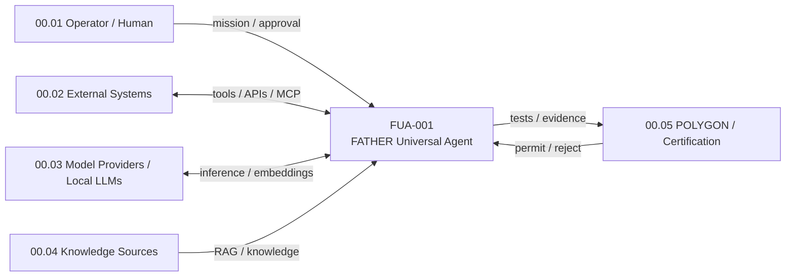
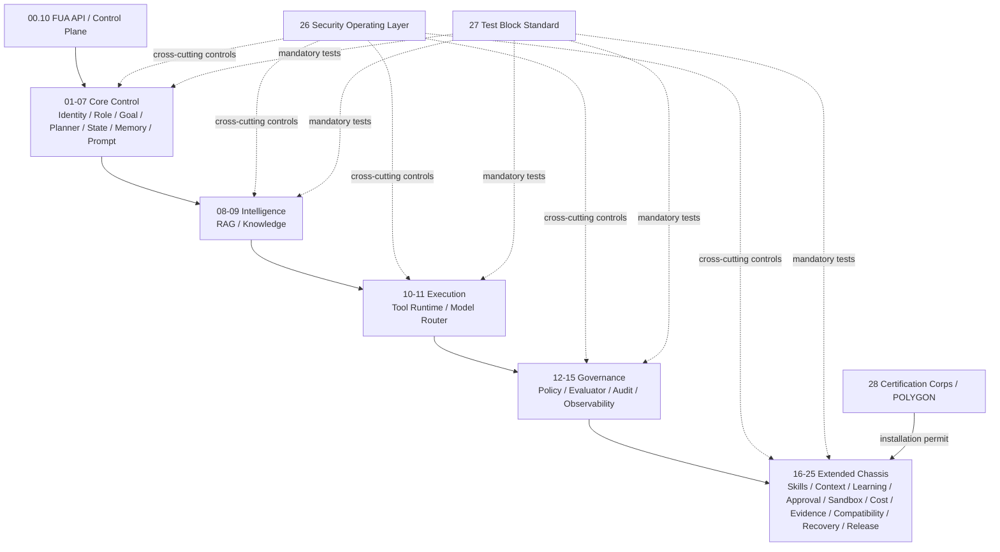
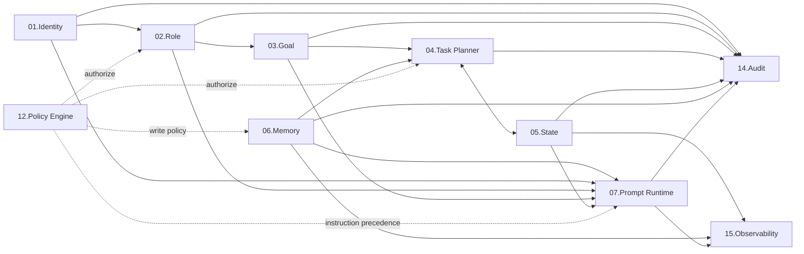
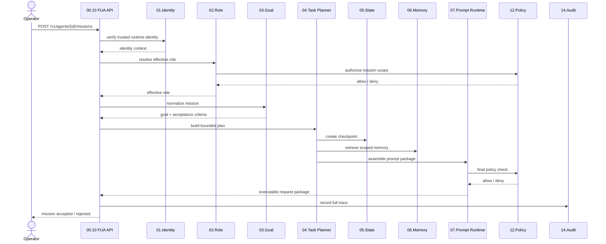

# FUA-001 — Architecture Diagrams (C4 + FATHER numbering)

Status: DESIGN DRAFT
Version: 0.1

## 00. Notation

Primary notation: C4 (Context → Container → Component).
FATHER military hierarchical numbering is preserved inside every component.
Security and DevSecOps are cross-cutting layers, not decorative side notes.

## 01. System Context



## 02. Container View



## 03. Core Component View 01-07



## 04. API boundary

The API is a control-plane boundary, not a trust shortcut.

```text
CLIENT
  ↓
00.10 API Gateway / Validation
  ↓
01.Identity authentication context
  ↓
02.Role + 12.Policy authorization
  ↓
03.Goal / 04.Planner / 05.State / 06.Memory / 07.Prompt
  ↓
14.Audit + 15.Observability + 22.Evidence
```

No API request may:
- self-assert elevated Trust Level;
- bypass Policy Engine;
- write durable memory without a write decision;
- mutate immutable identity fields;
- install a block without Installation Permit;
- invoke tools/models without authorization.

## 05. Sequence — mission execution


