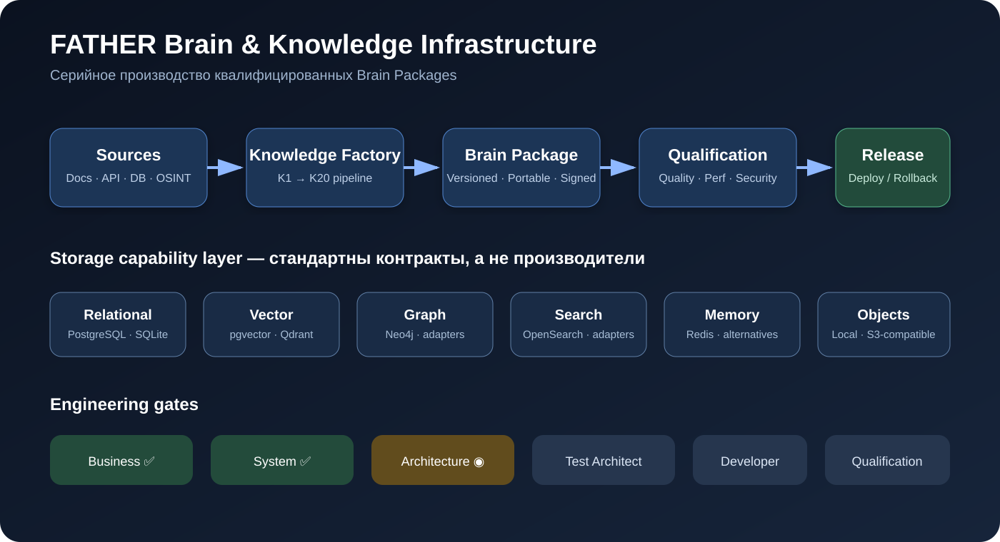
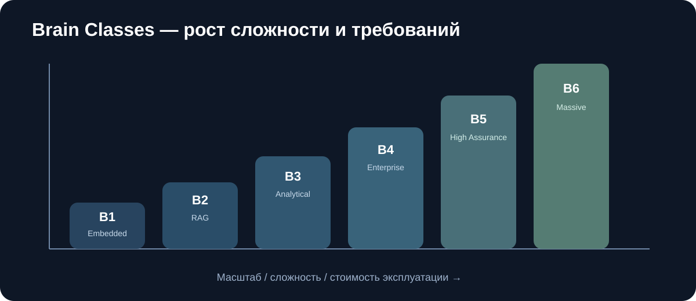
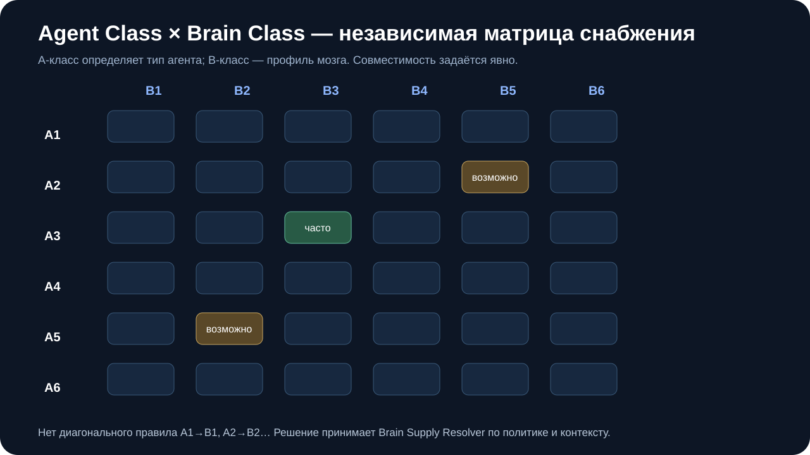
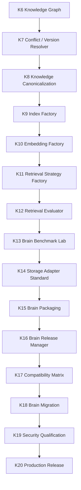
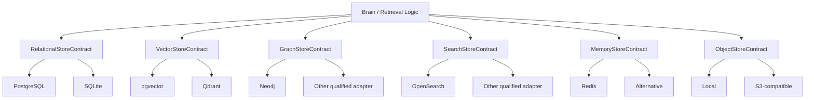
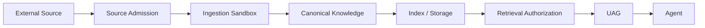
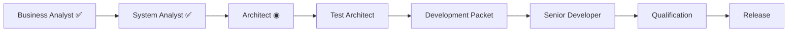

# FATHER Brain & Knowledge Infrastructure

<p align="center">
  <strong>Серийное производство, испытание и внедрение Brain Packages для агентов FATHER</strong>
</p>

<p align="center">
  
</p>

---

## Статус проекта

| Gate | Состояние |
|---|---|
| Business Analysis | ✅ PASS |
| System Analysis | ✅ PASS |
| Architecture | ✅ PASS for FTH-BRAIN-SUPPLY-001 |
| Test Architecture | ✅ PASS for FTH-BRAIN-SUPPLY-001 |
| Development Packet | ✅ ISSUED |
| Senior Developer | ✅ IMPLEMENTED |
| Qualification | ✅ FTH-BRAIN-SUPPLY-001 PASS — 188 regression tests |
| Release | ⏳ Planned |

> Правило FATHER: **никакой реализации до прохождения аналитических, архитектурных и тестовых gate.**

---

## Зачем нужен этот проект

FATHER не должен создавать уникальную базу знаний заново для каждого агента.

Цель проекта — сделать знания отдельным серийным изделием:

```text
AGENT
+
BRAIN PACKAGE
+
MODEL
+
TOOLS
+
POLICY
=
PRODUCT
```

Brain Package должен быть:

- версионируемым;
- переносимым;
- воспроизводимым;
- тестируемым;
- безопасным;
- обновляемым;
- откатываемым;
- доказуемым через qualification evidence.

---

## Классы Brain

<p align="center">
  
</p>

| Class | Назначение | Пример |
|---|---|---|
| **B1 Embedded** | минимальный локальный мозг | FAQ, offline helper |
| **B2 RAG** | документный помощник | корпоративный RAG |
| **B3 Analytical** | профессиональный анализ | OSINT, ИБ, legal |
| **B4 Enterprise** | общая корпоративная knowledge fabric | multi-agent platform |
| **B5 High Assurance** | защищённые/критичные контуры | SOC, КИИ |
| **B6 Massive** | распределённая knowledge platform | Digital Twin, large OSINT |

---

## Agent Class × Brain Class

<p align="center">
  
</p>

**A-класс агента и B-класс мозга — независимые оси.**

Например:

```text
A3 Analyst + B3 Analytical        типичный вариант
A2 Standard + B5 High Assurance  допустимо при строгих требованиях доверия
A5 Security + B2 RAG             допустимо для небольшого защищённого RAG
```

Brain Supply Resolver проверяет обе оси отдельно и не делает скрытого правила A3 → B3.

---

## Производственная линия

```mermaid
flowchart LR
    A[Requirements] --> B[Brain Spec]
    B --> C[Source Admission]
    C --> D[Ingestion]
    D --> E[Normalization]
    E --> F[Entity / Relation]
    F --> G[Conflict / Version]
    G --> H[Canonical Knowledge]
    H --> I[Index Factory]
    I --> J[Retrieval Profile]
    J --> K[Qualification]
    K --> L[Brain Package]
    L --> M[Release]
    M --> N[Deploy]
    N --> O[Upgrade / Rollback / Revoke]
```



---

## Knowledge Factory roadmap

### Уже квалифицировано в chassis

```text
K1  Source Intake                         ✅
K2  Rights / Access / Provenance         ✅
K3  Structural Parser                    ✅
K4  Chunk Normalization                  ✅
K5  Entity / Relation Extraction         ✅
K6  Entity Resolution / Knowledge Graph  ✅
```

### Следующая производственная линия



---

## Storage is a capability, not a vendor

FATHER стандартизирует **интерфейс и qualification**, а не конкретного производителя.



---

## Как выбирается база

Не по популярности.

Factory должна учитывать:

- размер corpus;
- число объектов;
- vector count / dimensions;
- graph node/edge count;
- write rate;
- update frequency;
- retrieval mix;
- concurrency;
- latency SLO;
- availability;
- durability;
- security class;
- deployment target;
- cost ceiling;
- компетенции эксплуатации.

Результат — **ранжированные конфигурации с trade-offs**, а не один «любимый» стек.

---

## Knowledge Loading Profiles

| ID | Профиль | Для чего |
|---|---|---|
| KLP-01 | Static Documents | книги, регламенты, инструкции |
| KLP-02 | Continuous Documents | постоянно обновляемые репозитории |
| KLP-03 | DB Sync / CDC | корпоративные БД |
| KLP-04 | API Sync | внешние и внутренние API |
| KLP-05 | Web / OSINT | открытые источники |
| KLP-06 | Event Stream | события, телеметрия, SIEM |
| KLP-07 | Expert Curation | экспертное наполнение |
| KLP-08 | Generated Knowledge | производные знания с provenance |
| KLP-09 | Mixed | комбинированный профиль |

---

## Security-by-design



Security проходит через весь lifecycle:

- source trust;
- rights/access;
- data classification;
- malicious document defense;
- poisoning resistance;
- provenance;
- integrity;
- tenant isolation;
- authorization;
- secrets/keys;
- backup/restore;
- signed releases;
- rollback/revocation;
- POLYGON adversarial tests.

---

## Метрики qualification

### Knowledge quality

- Recall@K
- Precision@K
- MRR
- NDCG
- Grounding
- Citation Accuracy
- Entity / Relation Accuracy
- Conflict Resolution Accuracy

### Performance

- latency p50 / p95 / p99
- throughput
- ingest rate
- index build time
- rebuild time

### Resources & economics

- CPU
- RAM
- GPU
- disk
- network
- cost/query
- cost/1M chunks
- maintenance effort

### Reliability & security

- availability
- backup / restore
- rollback
- poisoning resistance
- unauthorized retrieval blocking
- provenance integrity
- isolation violations

---

## FATHER engineering workflow



Первый реализуемый блок **FTH-BRAIN-SUPPLY-001 QUALIFIED**. Следующий этап: Storage Profile / Storage Selection Engine.

---

## Артефакты проекта

- [01 — Business Analysis](./01_BUSINESS_ANALYSIS.md)
- [02 — System Analysis](./02_SYSTEM_ANALYSIS.md)
- [03 — Architecture](./03_ARCHITECTURE.md)
- [04 — Test Architecture](./04_TEST_ARCHITECTURE.md)
- [05 — Development Packet](./05_DEVELOPMENT_PACKET.md)
- [06 — Local Qualification Runbook](./06_LOCAL_QUALIFICATION_RUNBOOK.md)
- [07 — Architect & Operator Decision Guide](./07_ARCHITECT_DECISION_GUIDE.md)
- [08 — Bench Test Program](./08_BENCH_TEST_PROGRAM.md)

Следующие ожидаемые артефакты:

- `03_ARCHITECTURE.md`
- `04_TEST_ARCHITECTURE.md`
- `05_DEVELOPMENT_PACKET.md`
- qualification evidence
- ADR
- compatibility matrix
- benchmark matrix

---

## Definition of Done

Проект не считается завершённым, пока FATHER не докажет серийную линию:

```text
requirements
→ brain design
→ source loading
→ storage selection
→ build
→ benchmark
→ security qualification
→ package
→ release
→ deployment
→ upgrade / rollback
```

минимум для нескольких Brain classes и нескольких взаимозаменяемых storage implementations.

---

<p align="center">
  <strong>FATHER: стандартны контракты, испытания и качество — реализации могут меняться.</strong>
</p>
